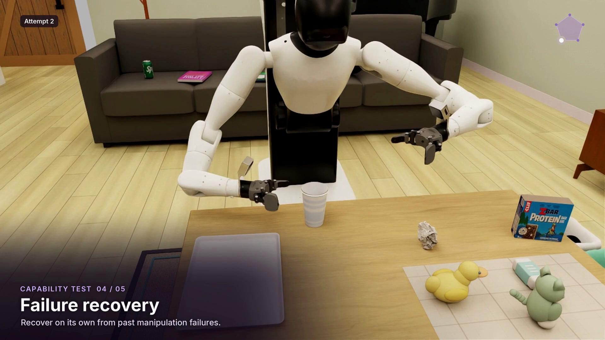

<div align="center">

<h1></h1>

A multi-level benchmark for robot agents in realistic household environments.

[Website](https://aetherlabsai.github.io/RobotAgentBench/) · [Watch the video](docs/media/overview.mp4) · [Benchmark](docs/BENCHMARK.md) · [Quick start](#quick-start) · [Installation](docs/INSTALL.md) · [Runtime](docs/RUNTIME.md)

[](docs/INSTALL.md)
[](docs/INSTALL.md#native-environment)
[](LICENSE)

</div>

<!-- overview-video:start -->
<p align="center">
  <a href="docs/media/overview.mp4"></a><br>
  <strong><a href="docs/media/overview.mp4">▶ Watch RobotAgentBench in action</a></strong>
</p>
<!-- overview-video:end -->

## Overview

**RobotAgentBench** evaluates household robot agents in simulation, from explicit manipulation instructions to high-level requests that require discovering and coordinating multiple tasks. The benchmark uses the **AgiBot G1** embodiment, egocentric camera observations, and physically grounded process scores.

- **Everyday manipulation.** Prepare coffee, use appliances, organize belongings, handle tablecloths, and move objects between household locations.
- **Beyond task completion.** Probe task discovery, context reasoning, failure recovery, and robustness to execution-time disturbances.
- **Open-ended assistance.** Combine household memory with scene observations to decide what to do, in what order, and how to preserve earlier results.
- **Execution-grounded evaluation.** Task owners award process credit from measured simulation evidence—not from a plan, a tool call, or an agent's claim of success.

<p align="center">
  <a href="docs/images/robotagentbench-overview.png"></a>
</p>

## Benchmark at a glance

| Evaluation | Scope | What it measures |
| :-- | :-- | :-- |
| **Manipulation** | 18 short tasks | Executing explicit household manipulation instructions |
| **Long tasks** | 8 composite tasks | Coordinating several subgoals in one continuous scene |
| **Task Discovery** | Scenario-conditioned exploration | Identifying and touching task-relevant objects |
| **Context Reasoning** | Drink, snack, waste, and sofa-object selection | Choosing the correct object from context |
| **Failure Recovery** | Predefined failed-action states | Recognizing a failed state and adapting subsequent actions |
| **Robustness** | Object movement and lighting disturbances | Continuing the objective as execution conditions change |
| **OpenEnd** | Dinner, guests, leaving, and tidying | Inferring, planning, and executing tasks from a high-level request |

The 18 short tasks contribute to the **Manipulation score**. The eight long tasks are evaluated separately. These benchmark counts are not the number of identifiers in the software catalog: catalogs also include variants and reusable scenario components.

See the [benchmark guide](docs/BENCHMARK.md) for the task list and scoring distinctions.

## Quick start

### 1. Install the evaluation core

Use **Python 3.11 or newer**. From a checkout of this repository:

```sh
python3 -m venv .venv
. .venv/bin/activate
python -m pip install .
python -m robotagentbench --help
```

The core package has no third-party Python runtime dependencies. You can inspect the catalogs without Isaac Sim, a GPU, assets, or model credentials.

### 2. Explore the catalogs

```sh
python -m robotagentbench catalog standalone
python -m robotagentbench catalog openend --format json
```

`standalone` lists task and variant identifiers. `openend` lists reusable scenario component types—not the four scenario episodes or their scoring denominators.

### 3. Install assets and configure a task workspace

Download the matching [asset release](https://huggingface.co/datasets/DylanHel/RobotAgentBench-assets)
and configure a local workspace:

```sh
robotagentbench assets fetch resources/assets-0.1.0.json --cache downloads
robotagentbench assets install resources/assets-0.1.0.json --cache downloads --destination Assets
robotagentbench assets configure resources/assets-0.1.0.json --destination Assets --runtime Runtime --profile room
```

Follow the [coffee example](docs/EXAMPLE.md) to build the native environment,
prepare an episode and connect an agent through the observation/action protocol.

The repository includes task initialization, randomization, physical-state readers,
process scoring, and native execution code. The [bundled backends](docs/BACKENDS.md)
cover room tasks, coffee disturbances, failure recovery, and tablecloth tasks.
Download the version-matched [asset release](docs/ASSETS.md) separately and install
Isaac Sim in a compatible native environment.

## Native evaluation

The agent interacts through synchronized observations and validated action chunks. The task owner retains responsibility for initialization, process scoring, progress timeouts, and termination.

| Interface | Configuration |
| :-- | :-- |
| Embodiment | AgiBot G1 |
| Visual observations | One head camera and two wrist cameras |
| Image resolution | Head: 1280 × 800; each wrist: 848 × 480 |
| Control | 20 Hz; task-selected physical substeps |
| Action representation | 20 joint targets in physical units and two mobile-base velocity commands |
| Evaluation feedback | Task-specific process scores and terminal outcomes |

These image sizes describe the generic room profile. Specialized owners retain
their original profiles; see [specialized owners](docs/SPECIALIZED.md).

Native execution runs in a dedicated worker with reviewed source and asset bindings. Specialized recovery, atomic-coffee, and cloth owners require their corresponding integrations; they do not silently fall back to an unrelated backend. See [native control and lifecycle](docs/RUNTIME.md).

Results contain task-specific process scores, completion status, and a termination
reason. Setup or runtime errors are reported separately from scored episodes.

## Documentation

| Guide | Start here to… |
| :-- | :-- |
| [Benchmark](docs/BENCHMARK.md) | Understand task families, scenarios, and evaluation scope |
| [Installation](docs/INSTALL.md) | Set up the core and review native prerequisites |
| [Coffee example](docs/EXAMPLE.md) | Install assets, prepare an episode, and connect to the task worker |
| [Backend source](docs/BACKENDS.md) | Locate the included task implementations and runtime profiles |
| [Assets](docs/ASSETS.md) | Download, install, and verify a versioned asset release |
| [CLI reference](docs/CLI.md) | Inspect catalogs, verify resources, and invoke configured native operators |
| [Tablecloth tasks](docs/CLOTH.md) | Prepare and run the original native cloth owner |
| [Specialized owners](docs/SPECIALIZED.md) | Configure recovery and coffee-disturbance native interpreters |
| [Dependencies](docs/DEPENDENCIES.md) | Configure source, asset, interpreter, and native-library bindings |
| [Task resources](docs/RESOURCES.md) | Identify per-task asset and dependency requirements |
| [Runtime](docs/RUNTIME.md) | Integrate workers, observations, actions, scoring, and shutdown |
| [Third-party notices](docs/THIRD_PARTY.md) | Review software, dataset, and asset distribution boundaries |

## Repository structure

```text
src/robotagentbench/
├── tasks/          Task and OpenEnd component catalogs
├── backends/       Task implementations and versioned source profiles
├── interfaces/     Robot state and action contracts
├── runtime/        Action transport and session adapters
└── simulation/     Source admission, native workers, and resource lifecycle
docs/               Setup, benchmark, integration, and resource guides
tests/              CPU contract and lifecycle tests
```

## Contributing

For reproducible bug reports, include the task identifier, package revision, runtime profile, and a minimal error log. Remove credentials, private target bindings, and other sensitive configuration before sharing. Use [GitHub Issues](https://github.com/AetherLabsAI/RobotAgentBench/issues) for reports and questions.

Run the CPU tests from the repository root:

```sh
python -m unittest discover -s tests
```

## License

Original evaluation code is licensed under [Apache-2.0](LICENSE). Simulator software, native libraries, datasets, model weights, and scene, robot, and object assets retain their own terms. See [third-party notices](docs/THIRD_PARTY.md).
