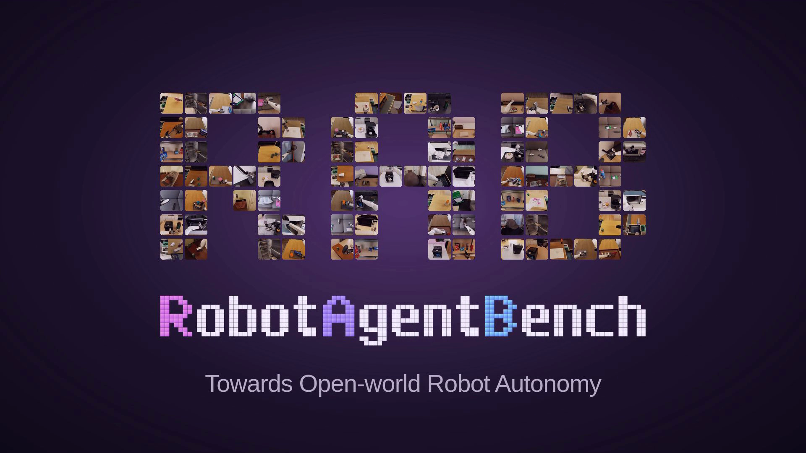
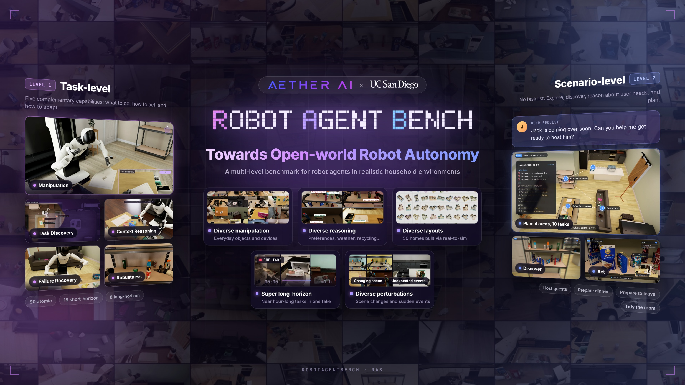

<div align="center">

<h1></h1>

A benchmark for household robot agents, from individual manipulation tasks to open-ended assistance.

[Website](https://aetherlabsai.github.io/RobotAgentBench/) · [Simulation assets](https://huggingface.co/datasets/AetherLabs-AI/RobotAgentBench-assets) · [InternVLA model](https://huggingface.co/AetherLabs-AI/InternVLA-A1.5-RAB) · [Quick start](#quick-start) · [Documentation](#documentation)

[](docs/INSTALL.md)
[](docs/INSTALL.md#native-environment)
[](LICENSE)
[](https://huggingface.co/datasets/AetherLabs-AI/RobotAgentBench-assets)

</div>

<!-- overview-video:start -->

https://github.com/user-attachments/assets/d8359d38-8793-4285-adf8-187603ba3736

<!-- overview-video:end -->

## Overview

**RobotAgentBench** is a simulation benchmark for household robot agents. Using the **AgiBot G1** embodiment, agents observe the home, identify what needs to be done, plan their actions, and execute them through a shared observation/action interface.

The benchmark spans everyday manipulation, task discovery, context reasoning, failure recovery, robustness, and open-ended scenarios. Task-specific process scores measure verified physical progress, including partial completion.

This repository contains the task backends, initialization and randomization, scoring, and evaluation runtime. Versioned simulation assets are available separately on [Hugging Face](https://huggingface.co/datasets/AetherLabs-AI/RobotAgentBench-assets).

<p align="center">
  <a href="docs/images/robotagentbench-overview.png"></a>
</p>

## Benchmark at a glance

| Evaluation | Scope | What it measures |
| :-- | :-- | :-- |
| **Manipulation** | 18 short tasks and 8 long tasks | Executing explicit household instructions, from individual manipulations to activities with multiple subgoals |
| **Task Discovery** | Scenario-conditioned exploration | Identifying and touching task-relevant objects |
| **Context Reasoning** | Drink, snack, waste, and sofa-object selection | Choosing the correct object from context |
| **Failure Recovery** | Predefined failed-action states | Recognizing a failed state and adapting subsequent actions |
| **Robustness** | Object movement and lighting disturbances | Continuing the objective as execution conditions change |
| **OpenEnd** | Dinner, guests, leaving, and tidying | Inferring, planning, and executing tasks from a high-level request |

Manipulation includes both short and long tasks. The reported Manipulation score uses the **18 short tasks**; the **8 long tasks** are evaluated separately.

See the [benchmark guide](docs/BENCHMARK.md) for the task list and scoring distinctions.

## Quick start

### 1. Install the code

Use **Python 3.11 or newer** and check out the evaluation code's `main` branch:

```sh
git clone --branch main https://github.com/AetherLabsAI/RobotAgentBench.git
cd RobotAgentBench
python3 -m venv .venv
. .venv/bin/activate
python -m pip install .
python -m robotagentbench --help
robotagentbench catalog standalone
```

The core package and catalog inspection do not require Isaac Sim, a GPU, or model credentials. Native simulation uses a separate environment described below.

### 2. Download assets

The [asset release](https://huggingface.co/datasets/AetherLabs-AI/RobotAgentBench-assets) is approximately **4.55 GB**, split into **18 archives**, including the license archive. It contains scene and robot resources, task objects, initialization data, and the full Context Reasoning question banks and standard answers.

```sh
robotagentbench assets fetch resources/assets-0.1.0.json --cache downloads
robotagentbench assets install resources/assets-0.1.0.json --cache downloads --destination Assets
robotagentbench assets configure resources/assets-0.1.0.json --destination Assets --runtime Runtime --profile room
```

The manifest pins an immutable asset revision and verifies file hashes. The commands create fresh `Assets` and `Runtime` directories; existing installations are not overwritten. For offline setup, place all archive parts in `downloads` and skip `fetch`. See the [asset guide](docs/ASSETS.md) for details.

Standard answers are evaluator data and are not included in agent observations.

### 3. Prepare and run an example

Native execution requires **Linux x86_64**, **Docker**, **NVIDIA Container Toolkit**, and an **Isaac Sim-compatible NVIDIA GPU**. Build the pinned native environment, then prepare the coffee task:

```sh
docker build -f docker/Dockerfile -t robotagentbench:native .
python -m robotagentbench.namespace --runtime Runtime --image robotagentbench:native --plan
python -m robotagentbench.namespace --runtime Runtime --image robotagentbench:native --prepare-native --name coffee_01
python -m robotagentbench.namespace --runtime Runtime --image robotagentbench:native --prepare --name coffee_01
```

`--prepare-native` creates this episode's private Kit/MDL caches and NVIDIA ICD configuration inside a CPU-only container. No host SDK installation is needed. Use the same image for preparation and execution; a changed image or an existing deployment is rejected.

Review the [NVIDIA license setup](docs/EXAMPLE.md#4-start-the-task). If you accept the applicable terms, start the task worker:

```sh
export OMNI_KIT_ACCEPT_EULA=YES
mkdir -p gpu-locks
python -m robotagentbench.namespace --runtime Runtime --image robotagentbench:native \
  --run --name coffee_01 --gpu 0 --lock-root gpu-locks
```

The worker exposes a JSONL observation/action interface for an agent or recorded action source. Starting the worker does not run a policy automatically. Follow the [coffee walkthrough](docs/EXAMPLE.md) for interaction examples and the [runtime guide](docs/RUNTIME.md) for agent integration. Use the same GPU-lock directory for all jobs on a host.

### 4. Choose a saved initial configuration

The saved-instance release provides **30 pre-generated initial configurations
per task or scenario**: 540 for the 18 short tasks, 240 for the 8 long tasks,
570 across the four additional evaluation dimensions, and 120 for the four
OpenEnd scenarios (**1,470 in total**). Choose an episode from 1–30 and reuse
its saved initial state; running a model does not resample it.

The download stores initial-state data, not a complete room copy per episode.
Positions, orientations, robot initialization and task parameters reuse the
shared assets; cloth tasks also retain their required cloth-state arrays.
The configuration download is approximately **232 MB**, split into six archives,
and is separate from the shared simulation assets.

These are **release configurations for reproducible evaluation**, not the
exact evaluation instances used for the paper's reported results. Episode
numbers identify saved configurations, not a promise that the original sampler
accepted seeds 1–30. The release records each configuration's actual seed.

See [saved configurations](docs/INSTANCES.md) for download, selection, and
read-only execution setup.

### 5. Connect a model or Robo Agent

Two optional clients reuse the project's server evaluation code:

- [InternVLA-A1.5](src/robotagentbench/model_examples/internvla/README.md): download our fine-tuned model from [AetherLabs-AI/InternVLA-A1.5-RAB](https://huggingface.co/AetherLabs-AI/InternVLA-A1.5-RAB), then use the matching G1 statistics and action projection.
- [Codex Robo Agent](src/robotagentbench/model_examples/codex/README.md): the App Server runner and robot tools, with a Dockerfile and locked dependencies for a locally built code-execution sandbox. No server-specific image ID is required.

For example, after creating the corresponding configuration:

```sh
# InternVLA: the configured model environment and native worker use separate GPUs.
python -m robotagentbench.model_examples internvla run \
  --config internvla-run.json --task short01 --output /absolute/path/to/fresh/run

# Codex: uses your own Codex login and can consume model usage.
python -m robotagentbench.model_examples.codex /absolute/path/to/operator.json --execute
```

Follow the two linked guides for installation and the full configuration commands.
The model examples require a separately installed native SDK/environment, or an
explicit container namespace; the coffee worker command above does not load a
model or create these configurations. Neither client bundles credentials or
changes task scoring.

## Evaluation interface

Agents receive synchronized camera observations, measured robot-state feedback, task-provided context, and an explored navigation map through the generic native worker. The map shows known static geometry, robot pose, and the executed path—not task targets or planned routes. Agents submit physical action chunks; the standard room profile uses one head camera and two wrist cameras with a 20 Hz control interface. Each task handles its own process scores, completion conditions, and termination. See the [observation contract](docs/RUNTIME.md#model-visible-observations) for field names and execution-profile scope.

Results include process scores, completion status, and a termination reason. Setup and runtime errors are reported separately from scored episodes. Camera, physics, and execution settings for specialized tasks are described in the [task backend guides](docs/BACKENDS.md).

## Documentation

| Guide | Start here to… |
| :-- | :-- |
| [Benchmark](docs/BENCHMARK.md) | Understand task families, scenarios, and evaluation scope |
| [Installation](docs/INSTALL.md) | Install the evaluator and native dependencies |
| [Coffee example](docs/EXAMPLE.md) | Install assets, prepare an episode, and connect to the task worker |
| [Task backends](docs/BACKENDS.md) | Locate task implementations and execution profiles |
| [Assets](docs/ASSETS.md) | Download, install, and verify a versioned asset release |
| [Saved configurations](docs/INSTANCES.md) | Select one of 30 saved initial configurations without resampling |
| [InternVLA example](src/robotagentbench/model_examples/internvla/README.md) | Download the fine-tuned model and run a VLA policy |
| [Codex example](src/robotagentbench/model_examples/codex/README.md) | Configure and run a code-based Robo Agent |
| [CLI reference](docs/CLI.md) | Inspect catalogs, verify resources, and invoke configured native operators |
| [Tablecloth tasks](docs/CLOTH.md) | Configure the separate cloth environment |
| [Recovery and coffee variants](docs/SPECIALIZED.md) | Configure specialized execution environments |
| [Runtime](docs/RUNTIME.md) | Integrate workers, observations, actions, scoring, and shutdown |
| [Licenses and notices](docs/THIRD_PARTY.md) | Read asset and dependency licensing terms |

## Repository structure

```text
src/robotagentbench/
├── tasks/          Task and OpenEnd component catalogs
├── backends/       Task implementations and versioned source profiles
├── interfaces/     Robot state and action contracts
├── runtime/        Action transport and session adapters
└── simulation/     Source admission, native workers, and resource lifecycle
docs/               Setup, benchmark, integration, and resource guides
tests/              CPU contract and lifecycle tests
```

## Contributing

For questions and bug reports, use [GitHub Issues](https://github.com/AetherLabsAI/RobotAgentBench/issues). Include the task identifier, code revision, execution profile, and a minimal reproduction. Do not include credentials or sensitive configuration.

Run the CPU tests from the repository root:

```sh
python -m unittest discover -s tests
```

## License

- **Evaluation code:** [Apache-2.0](LICENSE).
- **Team-authored assets and task data:** [CC BY 4.0](https://huggingface.co/datasets/AetherLabs-AI/RobotAgentBench-assets/blob/main/LICENSE.md).
- **Third-party materials:** retain their original terms, including CC BY-NC-SA 4.0 for the AgiBot GenieSim robot resources. See [third-party notices](docs/THIRD_PARTY.md) and the [asset notices](https://huggingface.co/datasets/AetherLabs-AI/RobotAgentBench-assets/blob/main/NOTICE.md).

## Citation

If you use RobotAgentBench in your research, please cite:

```bibtex
@misc{mao2026robotagentbenchopenworldrobotautonomy,
  title={RobotAgentBench: Towards Open-world Robot Autonomy},
  author={Lingjun Mao and Jinglin Cao and Lukun He and Wenpeng Xu and
          Yuchen Yan and Hengyu Jin and Zijun Zhang and Jinzhou Tang and
          Songyao Jin and Ziche Liu and Yifei Shao and Junbo Huang and
          Fang Nan and Ruobing Han and Ziqiao Xi and Ziming Xu and
          Shuang Liang and Sibo Zhu and Wenyi Wu and Xinyue Wang and
          Yiming Huang and Xinkai Zou and Gao Zhu and Kun Zhou and Biwei Huang},
  year={2026},
  eprint={2610.34649},
  archivePrefix={arXiv},
  primaryClass={cs.RO},
  url={https://arxiv.org/abs/2610.34649},
}
```

## Join the community

Scan a code to join the RobotAgentBench group on WeChat, Slack or Discord, or open an invite link directly.

[**Join Slack**](https://join.slack.com/t/robot-hmv5305/shared_invite/zt-4ee4vo9ip-7AwiBh1QDUKleoiIt87BnA) · [**Join Discord**](https://discord.gg/hgNmXUFMU)

<table>
  <tr>
    <td align="center" width="240">
      <a href="https://aetherlabsai.github.io/RobotAgentBench/assets/img/wechat-qr-sq.png?v=1"></a><br>
      <strong>WeChat</strong>
    </td>
    <td align="center" width="240">
      <a href="https://join.slack.com/t/robot-hmv5305/shared_invite/zt-4ee4vo9ip-7AwiBh1QDUKleoiIt87BnA"></a><br>
      <strong>Slack</strong>
    </td>
    <td align="center" width="240">
      <a href="https://discord.gg/hgNmXUFMU"></a><br>
      <strong>Discord</strong>
    </td>
  </tr>
</table>
