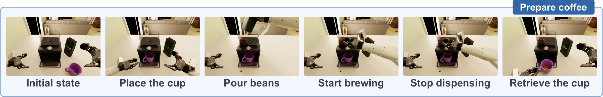

# Benchmark guide

[← Back to RobotAgentBench](../README.md)

RobotAgentBench evaluates five task-level capabilities—Manipulation, Task Discovery, Context Reasoning, Failure Recovery, and Robustness—and four open-ended household scenarios.

## Manipulation

Manipulation covers **18 short tasks** and **8 long tasks**, from individual household manipulations to composite activities with multiple subgoals.

### Short tasks

All 18 short tasks contribute to the Manipulation score. Each has its own physical process-score definition and completion conditions.

| # | Task | # | Task |
| :-- | :-- | :-- | :-- |
| 1 | Prepare coffee | 10 | Pack the bag |
| 2 | Load and unload the air fryer | 11 | Place cutlery on the tray |
| 3 | Stock the tray | 12 | Deliver the tray |
| 4 | Retrieve items from the drawer | 13 | Move sofa items to the table |
| 5 | Store items in the drawer | 14 | Store items in the basket |
| 6 | Hang the cap | 15 | Heat food and retrieve the plate |
| 7 | Clear table waste | 16 | Wipe the table |
| 8 | Move food to the microwave | 17 | Spread the tablecloth |
| 9 | Clear objects from the cloth | 18 | Collect the tablecloth |

Names describe benchmark tasks, not necessarily one-to-one software identifiers. Some registered identifiers are internal components or variants and are not additional short tasks.

### Long tasks

Long tasks combine several subgoals in a continuous physical scene. They are evaluated separately and **do not contribute to the Manipulation score**.

| # | Task | # | Task |
| :-- | :-- | :-- | :-- |
| 1 | Stock the tray (Multi) | 5 | Find and pack an item |
| 2 | Tidy the sofa area | 6 | Prepare a meal |
| 3 | Tidy the table | 7 | Prepare coffee and bread |
| 4 | Replace the tablecloth | 8 | Pack bags and baskets |

## Four diagnostic dimensions

| Dimension | Objective | Evidence |
| :-- | :-- | :-- |
| **Task Discovery** | Infer which objects need attention from household memory, a scenario request, and exploration | Coverage of distinct task-relevant objects through measured gripper contact |
| **Context Reasoning** | Select a drink, snack, waste item, or sofa object based on contextual requirements | The task's physical contact-based selection outcome |
| **Failure Recovery** | Continue from a predefined failed-action state, such as a missed grasp or tipped cup | Task-specific physical process scores during recovery |
| **Robustness** | Continue manipulation under object movement or illumination changes | Task-specific physical process scores under the original disturbance schedule |

Diagnostic variants need not inherit the entire completion chain of their base manipulation task. For example, selecting a product is different from carrying it to a tray. The prepared task's original owner defines scoring scope, timeout, and terminal conditions; the runtime does not impose one generic rule on every variant.

### Task Discovery contact budget

The release Task Discovery binding allows contact with at most **N + 2 distinct
physical objects**, where N is the number of unique targets. Targets and
non-targets both consume budget on first measured finger contact. Repeated
contacts, two hands, and collider children belonging to the same object count
once. Non-targets earn no points; coverage remains unique targets touched / N.
The contact exhausting the budget is included in scoring. The episode ends
after all targets are contacted, the budget is exhausted, or the original
180-second simulation-time no-progress timeout expires. The timeout is unchanged.

For simultaneous contacts within one native substep, the original stable
object-ID ordering is retained, without a target-priority pass or over-budget
awards. Unbound contacts indicate an incomplete evaluator object catalogue and
invalidate the episode instead of being treated as free touches or model zeros.
The already-admitted 20 Hz physical interval finishes normally; no later
contacts are banked after the terminal contact.

This approved rule is implemented by `robotagentbench.tasks.discovery` and is
attached automatically by the release's original-backend binding. Original
source files, scene hashes, physical contact readers and other tasks' scoring
remain unchanged. Directly invoking an old source worker does not enable the
new release rule. Episode outputs retain its explicit budget rule version.

## OpenEnd: four household scenarios

| Scenario | High-level objective |
| :-- | :-- |
| **Prepare dinner** | Coordinate meal-related preparation and household needs |
| **Host guests** | Prepare refreshments and make the room ready for a visit |
| **Prepare to leave** | Gather and organize the belongings needed before departure |
| **Tidy the room** | Restore household items and clear the relevant clutter |

Each episode's task specification determines the relevant objects, appliances, source locations, destinations, and initial states. The agent receives household memory, a scenario request, camera observations, and robot-state feedback—not the evaluator's underlying subtask list or target bindings.

Subtasks share the same physical scene and object instances, without resets between them. Process scores reflect verified physical progress. A plan or submitted task list does not itself earn credit. Task composition determines the available points; scenario names are not fixed scoring denominators. The selected OpenEnd source uses a shared 120-second simulation-time no-progress timeout, not a fixed total episode duration.

## Scores and results

Task-specific process scores measure physical execution progress. Each episode
also reports its completion status and termination reason. Setup and runtime
errors are recorded separately from valid scored outcomes.

For execution contracts and native requirements, continue to the [runtime guide](RUNTIME.md) and [resource guide](RESOURCES.md).
